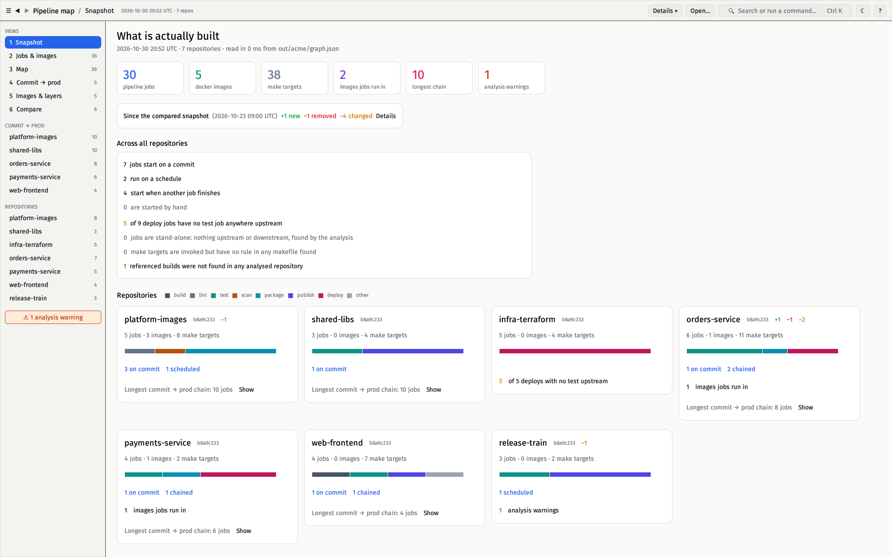

# pipeline-graph

Maps how CI/CD pipelines across many git repositories link together. TeamCity
and GitHub Actions are supported, and other systems plug in through
[one small interface](docs/development.md#adding-a-cicd-system):
build configurations, snapshot/artifact dependencies and finish-build triggers
(also across repos), the `make` targets each step runs, and the docker images
flowing between pipelines.

It is plain static analysis: a Kotlin DSL parser, a Makefile parser and a
shell-command scanner. No TeamCity server access, no AI, and nothing from the
repositories is executed.

```
$ make run
pipeline-graph: fetching 3 repositories into ~/.cache/pipeline-graph
out/pipelines.drawio
out/pipelines.vsdx
out/pipelines.html
out/pipelines.mmd
out/pipelines.dot
out/graph.json
out/warnings.txt
pipeline-graph: 3 repos, 8 build configurations, 11 make targets, 2 images, 1 external, 30 links, 3 warnings (see out/warnings.txt)
```


**[Try the live demo](https://avicted.github.io/tools.pipeline-graph/)**: the
HTML viewer for the [Acme example](examples/acme), rebuilt on every push.

### What it answers

| | |
|---|---|
| **DevSecOps:** *a CVE lands in a base image. What rebuilds, and what gets redeployed?* Click the image or its build: what it needs is ringed violet, what depends on it magenta. `B` keeps only the blast radius, `D` only the dependencies, `I` both. The URL points at exactly this view. |  |
| **DevSecOps:** *where are images pushed and pulled?* `/` searches names, TeamCity ids, step scripts and parameters across every view. |  |
| **Platform:** *how does a base image reach prod?* Select a job, then `Shift+click` another: only the routes between them stay, listed in order. The URL carries both ends. |  |
| **QA:** *what does this test job actually run, what triggers it, and what waits for it?* |  |
| **Everyone:** *walk the team through the path to prod.* `P` is a presentation mode for screen sharing. |  |

More in the [screenshot gallery](docs/screenshots/README.md), including the
make drill-down, edge tooltips and analysis warnings.

## Quick start

You need Docker and make, nothing else.

```sh
make run                      # first run: creates pipeline-graph.yaml with a demo and renders it
$EDITOR pipeline-graph.yaml   # put your repo URLs under `repos:`
make run                      # serves and opens http://localhost:8080/pipelines.html
```

### Your repos

Everything you edit is the `repos:` list in `pipeline-graph.yaml`:

```yaml
repos:
  - git@github.com:your-org/service-a.git     # a bare URL
  - url: git@github.com:your-org/base.git     # or a mapping: branch, name, provider, ...
    branch: main
  - ./checkout                                # a local directory, analysed as it is
```

Repos are shallow-cloned with git using your ssh-agent and `known_hosts`, and the
clones are cached in `~/.cache/pipeline-graph`. Local directories must be inside
this project directory, since only it is visible to the container.
[`pipeline-graph.example.yaml`](pipeline-graph.example.yaml) lists every option.

`make example` and `make example-github` render the larger fictional
[TeamCity](examples/acme) and [GitHub Actions](examples/github) examples.

## Outputs

| File | What it's for |
|------|---------------|
| `pipelines.drawio` | The main diagram. Pages: *Overview* (pipelines and images), *Pipelines + make*, and one per repo with its cross-repo neighbours. Repos are swimlanes, flow runs left to right, and each page has a legend and the commit SHAs it was built from. |
| `pipelines.vsdx` | The same pages as Visio, for importing into Miro. |
| `pipelines.html` | Self-contained interactive viewer (no CDN). See [The HTML viewer](docs/viewer.md). |
| `pipelines.mmd` | Mermaid flowchart of the overview; renders in GitHub/GitLab markdown and Miro's Mermaid app. |
| `pipelines.dot` / `.svg` | Graphviz source of the overview. The `.svg` is written only if `dot` is installed (the Docker image has it). |
| `graph.json` | The full graph model (`schemaVersion` 1), for scripting, diffing runs and the native viewer. A dated copy of every changed graph is kept in `history/`. |
| `warnings.txt` | Everything the analysis could not resolve. Nothing is dropped silently. |

## The native viewer

For a lot of pipelines (thousands of jobs, tens of thousands of make targets,
layered images) there is **pgview**, a native app made for whoever decides how
pipelines are built. It opens `graph.json` instantly, searches as you type, and
is built around one question: *what is actually built?* A snapshot page per
repository, a table of every job, the map, commit → prod, the image layers and
which jobs run in them, and a comparison against an earlier run to see drift.



```sh
make run && make view
```

See [pgview](docs/pgview.md).

## Docs

- [pgview, the native viewer](docs/pgview.md): screens, search, comparing runs, budgets
- [The HTML viewer](docs/viewer.md): shortcuts, lineage, sharing, Miro import
- [What is analysed](docs/analysis.md): recognised constructs, cross-repo references, limits
- [Development](docs/development.md): devcontainer, adding a CI/CD system, tests, quality gate, layout

## License

GNU General Public License v3.0. See [LICENSE](LICENSE).
