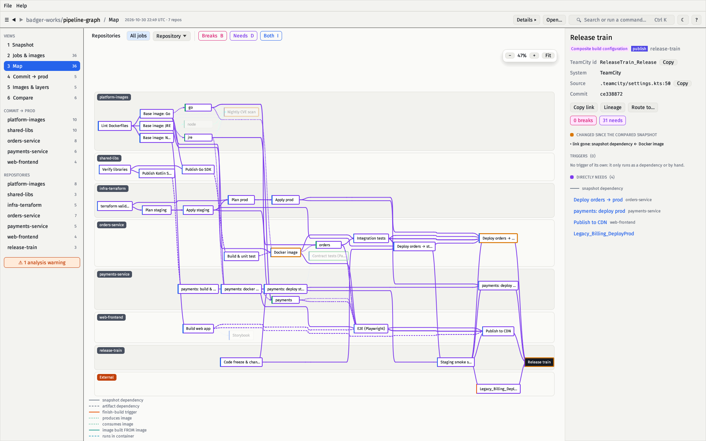

# pipeline-graph

Maps how CI/CD pipelines across many git repositories link together.

- **CI systems:** TeamCity (Kotlin DSL) and GitHub Actions. Others plug in
  through [one interface](docs/development.md#adding-a-cicd-system).
- **What is read:** build configurations and workflow jobs, snapshot/artifact
  dependencies, finish-build triggers (also across repos), the `make` targets
  each step runs, and the docker images built, pulled and run in.
- **How:** static analysis only: a Kotlin DSL parser, a workflow YAML reader,
  a Makefile parser and a shell-command scanner. No CI server access, no AI, nothing from the
  repositories is executed.

```
$ make run
pipeline-graph: fetching 7 repositories into ~/.cache/pipeline-graph
out/pipelines.drawio
out/pipelines.vsdx
out/pipelines.mmd
out/pipelines.dot
out/graph.json
out/history/20261030T2320Z-15fc7ecd.json
out/warnings.txt
pipeline-graph: 7 repos, 30 jobs, 38 make targets, 5 images, 1 external, 133 links, 1 warnings (see out/warnings.txt)
```



### What it answers

The native viewer ([below](#the-native-viewer)) opens `graph.json`.

| | |
|---|---|
| **DevSecOps:** *a CVE lands in a base image. What rebuilds, and what gets redeployed?* Select the image or its build: what it needs is violet, what depends on it pink. `B` keeps only the blast radius, `D` only the dependencies, `I` both. |  |
| **DevSecOps:** *where are images pushed and pulled?* **Images & layers** shows the base → application tree, who builds and uses each image and which jobs run inside it. |  |
| **Platform:** *how does a base image reach prod?* Select a job, then `Shift+click` another: only the routes between them stay. |  |
| **QA:** *what does this test job actually run, what triggers it, and what waits for it?* The inspector lists steps, scripts, triggers, container and neighbours. |  |
| **Everyone:** *what changed since the last run?* **Compare** lists the jobs added, removed and changed against an earlier `graph.json` from `out/history/`. |  |

## Quick start

Requires Docker and make. The native viewer additionally needs a Rust
toolchain (`cargo`).

```sh
make run                      # first run: creates pipeline-graph.yaml with a demo and renders it
$EDITOR pipeline-graph.yaml   # put your repo URLs under `repos:`
make run                      # writes the diagrams and graph.json to out/
make view                     # opens out/graph.json in the native viewer
```

### Your repos

Everything you edit is the `repos:` list in `pipeline-graph.yaml`:

```yaml
repos:
  - git@github.com:your-org/service-a.git     # a bare URL
  - url: git@github.com:your-org/base.git     # or a mapping: branch, name, provider, ...
    branch: main
  - ./checkout                                # a local directory, analysed as it is
```

A CI system with settings of its own gets a block named after it, for every
repo or for one (`teamcity: {dir: ci/tc, project_id: Base}`).

Repos are shallow-cloned with git using your ssh-agent and `known_hosts`, and the
clones are cached in `~/.cache/pipeline-graph`. Local directories must be inside
this project directory, since only it is visible to the container.
[`pipeline-graph.example.yaml`](pipeline-graph.example.yaml) lists every option.

`make example` and `make example-github` render the larger fictional
[TeamCity](examples/acme) and [GitHub Actions](examples/github) examples.

## Outputs

| File | What it's for |
|------|---------------|
| `pipelines.drawio` | The main diagram. Pages: *Overview* (pipelines and images), *Pipelines + make*, and one per repo with its cross-repo neighbours. Repos are swimlanes, flow runs left to right, and each page has a legend and the commit SHAs it was built from. |
| `pipelines.vsdx` | The same pages as Visio, for importing into Miro (see [below](#importing-into-miro)). |
| `pipelines.mmd` | Mermaid flowchart of the overview; renders in GitHub/GitLab markdown and Miro's Mermaid app. |
| `pipelines.dot` / `.svg` | Graphviz source of the overview. The `.svg` is written only if `dot` is installed (the Docker image has it). |
| `graph.json` | The full graph model (`schemaVersion` 1), for scripting, diffing runs and the native viewer, which is how you explore it. A dated copy of every changed graph is kept in `history/`. |
| `warnings.txt` | Every reference or file the analysis could not resolve. |

### Importing into Miro

Use **Upload → Visio (.vsdx)** with `pipelines.vsdx` and pick the pages to
import. Colours and formatted text are kept, and connectors stay glued to
their shapes. `pipelines.drawio` is the editable version for diagrams.net and
Confluence.

## The native viewer

`pipeline-graph-viewer` is a Rust/egui desktop app that opens `graph.json`.
No server, browser or network. On a synthetic 48,000-node graph (3,000 jobs,
45,000 make targets) it loads in about 0.3 s and uses about 30 MB; the budgets
are checked by `make viewer-bench`.


| Screen (key) | Shows |
|---|---|
| Snapshot (`1`) | Counts of jobs, images, make targets, images jobs run in, longest commit → prod chain and analysis warnings; **Worth a look** (load-bearing jobs, deploys with no test upstream, undefined builds, cycles, unused images, stand-alone jobs, make targets with no rule); how work starts; a card per repository. Every number opens the table filtered to what it counts. |
| Jobs & images (`2`) | Every job, image and make target with stage, triggers, images, **Needs** (all upstream) and **Breaks** (all downstream). Sortable, filterable (`repo:`, `kind:`, `class:`, `trig:`, `is:`). |
| Map (`3`) | Repositories, one repository, all jobs, or one job's lineage. Needs in violet, breaks in pink; `Shift`+click keeps the route between two jobs. |
| Commit → prod (`4`) | Per repository, every job a commit starts and everything downstream, in dependency order. |
| Images & layers (`5`) | Base → application image tree, who builds and uses each image, which jobs run inside it. |
| Compare (`6`) | Jobs added, removed and changed (with the field) against an earlier `graph.json` from `out/history/`. |

Selecting a job opens the inspector: CI system and id, source file and line,
triggers, container, direct needs and dependents, make targets and steps.
Jobs are named in the terms of their CI system. `Ctrl`/`⌘`+`K` searches and
runs commands, and `?` shows shortcuts and a legend. The File menu opens,
closes, reloads and saves a copy of a `graph.json`; the viewer never modifies it.


```sh
make run && make view
make view GRAPH=out/acme/graph.json COMPARE=viewer/testdata/acme-previous.json
```

See [the viewer guide](docs/viewer.md).

## Docs

- [The viewer](docs/viewer.md): screens, search, comparing runs, budgets
- [What is analysed](docs/analysis.md): recognised constructs, cross-repo references, limits
- [Architecture](docs/architecture.md): the system on one page; detail pages in [docs/architecture/](docs/architecture/) cover the CLI, security, the `graph.json` contract, the viewer, the quality gate and release
- [Development](docs/development.md): devcontainer, adding a CI/CD system, tests, quality gate, layout

## License

GNU General Public License v3.0. See [LICENSE](LICENSE).
