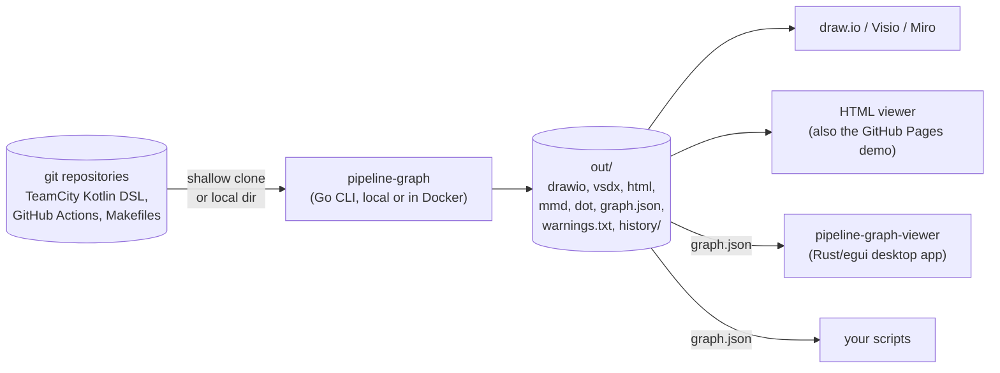
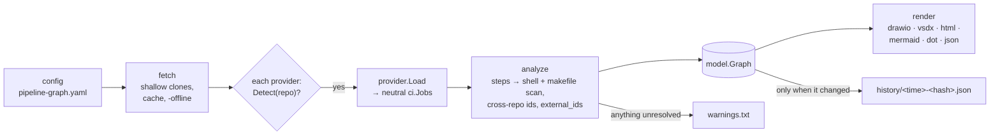
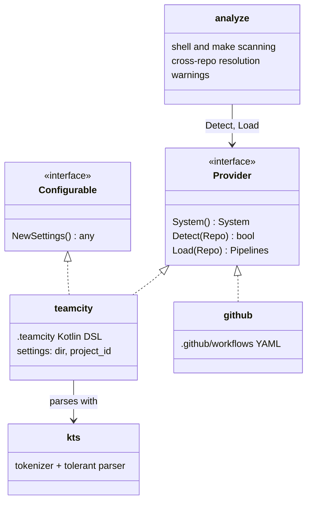
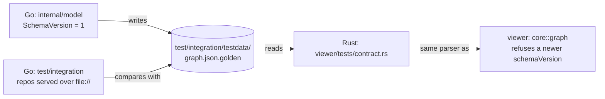
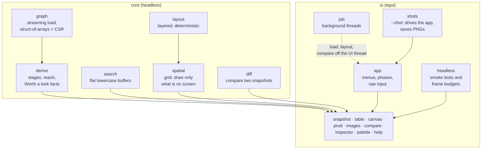
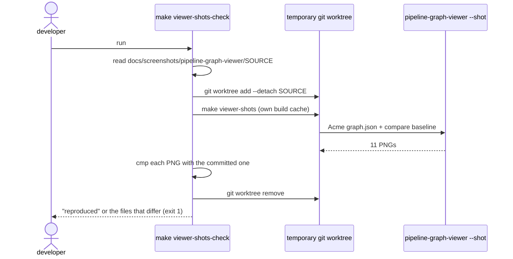
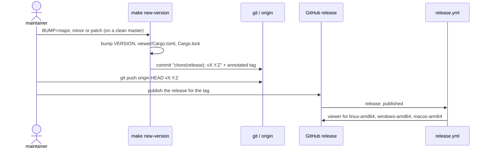

# Architecture

pipeline-graph has two programs that share one file format:

- **`pipeline-graph`** (Go, `cmd/pipeline-graph`) reads CI/CD definitions from git
  repositories and writes diagrams plus `graph.json`.
- **`pipeline-graph-viewer`** (Rust/egui, `viewer/`) is a desktop app that reads
  `graph.json` and lets you explore it.

Everything below is static analysis: no CI server is contacted and nothing from the
analysed repositories is executed.

## System context

## The CLI pipeline

One run is a straight pipeline. Each stage is a package under `internal/`, and only
`cmd/pipeline-graph` knows the order.

| Package | Responsibility |
|---|---|
| `internal/config` | Loads the YAML, folds deprecated keys into provider blocks, reports notices |
| `internal/fetch` | Shallow `git clone` with the system git and BatchMode ssh; local directories are cloned too, so every repo has a commit |
| `internal/ci` | The provider seam (below) and the neutral job model |
| `internal/kts` | Tolerant Kotlin tokenizer and parser for the TeamCity DSL |
| `internal/shell`, `internal/makefile` | Find `make`, `docker` and script calls in step text; parse Makefiles |
| `internal/analyze` | Turns every provider's jobs into one graph; resolves references across repositories |
| `internal/model` | The graph types and `graph.json` (`SchemaVersion`) |
| `internal/layout`, `internal/render` | Layered left-to-right layout with repository lanes; every output format |

## The provider seam

Everything that is the same for every CI system lives on the shared side. A provider
only reads one system's files and names its concepts.

`Load` returns neutral `ci.Job`s (key, qualified id and aliases, steps, dependencies,
triggers, artifact rules). Adding a system means one new package and one line in
`cmd/pipeline-graph/main.go`; see
[Adding a CI/CD system](development.md#adding-a-cicd-system).

## The `graph.json` contract

`graph.json` is the only interface between the Go and Rust halves. Both sides are tied
to one golden file, so neither can change it alone.

- A change to the model fails the Go integration test until the golden file is
  regenerated (`-update`), and that regenerated file then has to pass the viewer's
  contract test.
- The viewer refuses a file whose `schemaVersion` is newer than its own, rather than
  showing it half-understood.

## The viewer

The viewer is split so that everything except drawing can run headless: in unit
tests, in the benchmarks, and in CI.

The budgets are checked on a synthetic graph with 48,000 nodes by `make viewer-bench`.
That graph loads in about 0.3 s and stays at about 30 MB.

## Verification

| What | How | Where it runs |
|---|---|---|
| Go, Rust, shell, Dockerfiles, Makefile, secrets | pre-commit in a pinned Docker image (`Dockerfile.pre-commit`) | git hooks; `lint.yml` on every PR |
| Analyzer behaviour | unit tests, the integration test with golden files | `go test` (in the gate) |
| `graph.json` contract | `viewer/tests/contract.rs` against the golden file | `cargo test` (in the gate) |
| Viewer screens | `ui::headless` smoke tests drive every screen | `cargo test` (in the gate) |
| Viewer performance | load, search, lineage, layout and frame budgets | `make viewer-bench` |
| README sample output | `TestReadmeSampleOutput` runs the shipped demo | `go test` (in the gate) |
| Viewer screenshots | rebuilt from their `SOURCE` commit, compared byte for byte | `make viewer-shots-check` (needs a display) |
| HTML viewer screenshots | headless Chromium in `Dockerfile.screenshots` | `make screenshots` |

The screenshot run is made deterministic: no live mouse or keyboard input, the window
always counts as focused, a fixed 2000×1250 output, no animation, the time comes from
the commit (`SOURCE_DATE_EPOCH`), and the load time is left out.

## Release

`VERSION` is the only place the version lives. `pipeline-graph -version`, the Docker
image tag and the viewer's About dialog all derive from it. `make undo-version` takes
back a release that hasn't been pushed.

## Decisions and trade-offs

| Decision | Why | Cost |
|---|---|---|
| Static analysis only | Safe on any repository, no credentials for a CI server, reproducible | Whatever is decided at run time (parameters, generated config) is invisible; it shows up in `warnings.txt` |
| One neutral job model behind `ci.Provider` | A new CI system doesn't touch analysis or rendering | The model is the common denominator; system-specific detail has to fit `ci.Job` |
| `graph.json` as the only Go ↔ Rust interface | Two languages, one contract, tested on both sides | Every shape change touches two codebases and the golden file |
| A native egui viewer next to the HTML one | Tens of thousands of nodes at interactive speed | A second UI to maintain; builds per platform |
| Screenshots taken by the apps themselves | The docs show the real UI and can be rebuilt | Needs a display (native) or a Chromium image (web) |
| The quality gate runs in Docker | Same tool versions on every machine and in CI | Docker is required; the first run pulls the image |

## Known limits

Stated plainly, so nobody has to rediscover them:

- **Viewer screenshots are byte-identical only at the same display scaling.** At a
  different scaling the map and commit → prod pictures differ in the anti-aliasing of
  curved links. The camera is identical, so the cause is in rasterization; it isn't
  found yet.
- **`make viewer-shots-check` is manual.** It needs a display, so it isn't part of the
  gate or of CI.
- **Chromium isn't version-pinned** in `Dockerfile.screenshots`, because Debian removes
  superseded builds. The web screenshots can shift after a security update.
- **There's no written policy for bumping `schemaVersion`.** That covers when to bump it,
  and whether the viewer keeps reading older versions.
- **`make new-version` and `make undo-version` have no automated test.** Their guards
  were checked by hand; the full bump, commit and tag path hasn't run end to end.
