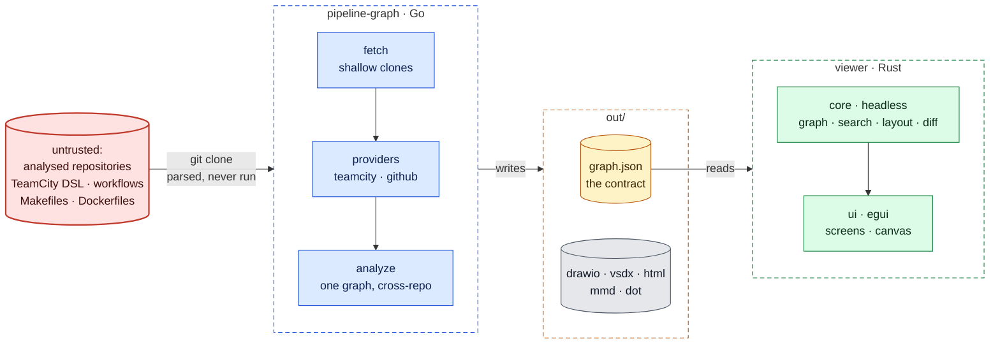

# Architecture

pipeline-graph has two programs that share one file format:

- **`pipeline-graph`** (Go, `cmd/pipeline-graph`) reads CI/CD definitions from git
  repositories and writes diagrams plus `graph.json`.
- **`pipeline-graph-viewer`** (Rust/egui, `viewer/`) is a desktop app for exploring
  `graph.json`.

This page is the big picture. Each part has a detail page in
[`architecture/`](architecture/), listed under [Read next](#read-next).

## Legend

The same in every diagram, on this page and the detail pages:

| Colour | Meaning |
|---|---|
| 🟥 red | untrusted input: the analysed repositories |
| 🟦 blue | the Go CLI |
| 🟨 amber | data files and the contract between the two programs |
| 🟩 green | the Rust viewer |
| ⬜ grey | generated output; manual steps in the quality gate |
| dashed box | a trust or runtime boundary |

## Overview

*Answers: what is the whole system, on one page?*

Everything runs on a developer's machine. There is no CI/CD and nothing is
published; git hooks are the quality gate.

## The parts

**The CLI.** It shallow-clones the configured repositories, lets a *provider* per CI
system (TeamCity Kotlin DSL, GitHub Actions) turn their files into neutral jobs, and
analyses those jobs into one graph: builds, make targets and images, linked across
repositories. A new CI system is one package behind `ci.Provider`; analysis and
rendering don't change. → [The CLI](architecture/cli.md)

**Security.** The analysed repositories are the only untrusted input. Their content is
parsed, never executed, inside a Docker container that sees only the project
directory, the clone cache and what git needs to authenticate.
→ [Security](architecture/security.md)

**The `graph.json` contract.** The only interface between Go and Rust. A golden file
written by the Go integration test must also parse in the Rust contract test, so
the two halves can't drift apart. → [The contract](architecture/contract.md)

**The viewer.** A headless `core` (graph, search, layout, diff; no egui) under an egui
`ui`. One immutable model is shared; the mutable workspace lives on the UI thread;
loading, layout and compare run on background threads.
→ [The viewer at run time](architecture/viewer.md)

**The quality gate.** Every check runs locally in one pinned Docker image: on commit,
on push, and again when the maintainer reviews a branch. The doc screenshots are
reproducible from a recorded commit, and a release is a version commit plus a tag.
→ [Quality gate, screenshots and release](architecture/quality.md)

## Read next

| If you want to … | Read |
|---|---|
| know what the tool understands, what one run does, or add a CI system | [cli.md](architecture/cli.md) |
| know what untrusted input can reach | [security.md](architecture/security.md) |
| change the shape of `graph.json` | [contract.md](architecture/contract.md) |
| work on the viewer's state, threads or screens | [viewer.md](architecture/viewer.md) |
| know what checks a commit, refresh screenshots, or cut a release | [quality.md](architecture/quality.md) |
| run the commands | [development.md](development.md) |

Known limits are listed in [quality.md](architecture/quality.md#known-limits); the
open question on `schemaVersion` is in [contract.md](architecture/contract.md#open-question).

## Decisions

| Context | Decision | Consequence |
|---|---|---|
| The tool reads repositories it doesn't own | Static analysis only; nothing from them is executed | Safe on any repository and needs no CI server credentials. Anything decided at run time is invisible and shows up in `warnings.txt` |
| Several CI systems, one picture | One neutral job model behind `ci.Provider` | A new system doesn't touch analysis or rendering; system-specific detail has to fit `ci.Job` |
| Two languages, Go and Rust | `graph.json` with a golden file tested on both sides | Every shape change touches both sides and the golden file, on purpose |
| Graphs with tens of thousands of nodes | A native egui viewer next to the HTML one | Interactive at that size, at the cost of a second UI and builds per platform |
| The docs must show the real UI | The apps take their own screenshots | They can be rebuilt and checked; that needs a display (native) or a Chromium image (web) |
| The same results on every machine | The quality gate runs in a pinned Docker image | Docker is required |
| An internal tool; nothing is published | No CI/CD: git hooks on every machine plus a review run before merging | Nothing hosted to maintain or pay for, and no secrets in a CI system. The gate holds only if everyone runs `make hooks` and reviews really run `pre-commit-pr-run` |
