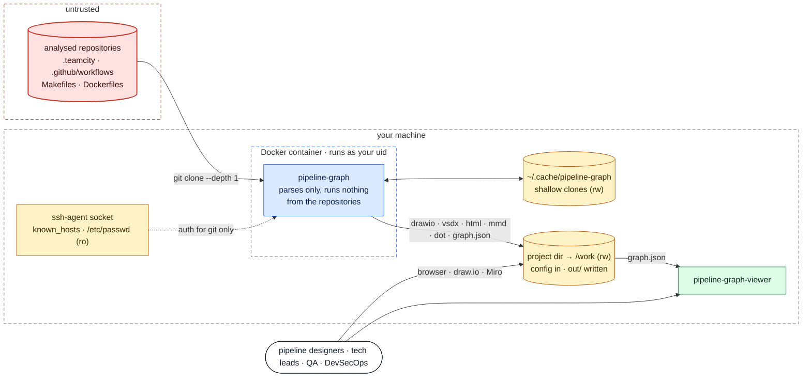
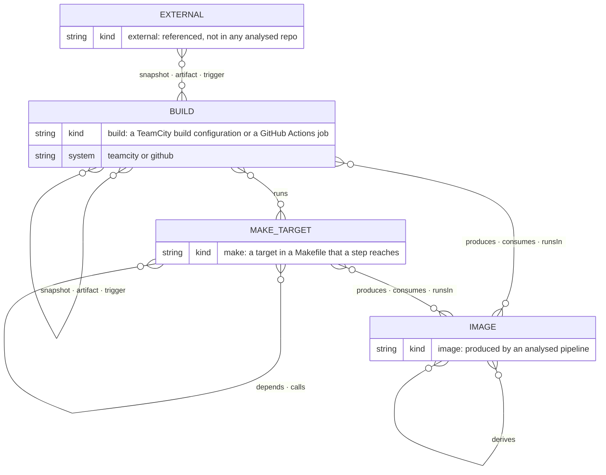
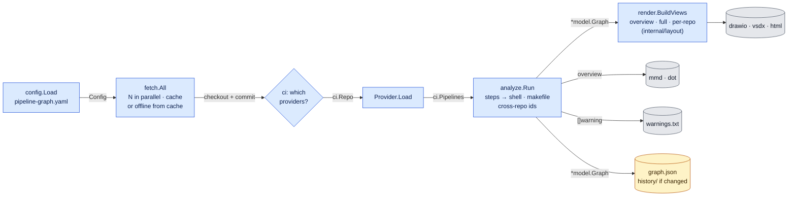
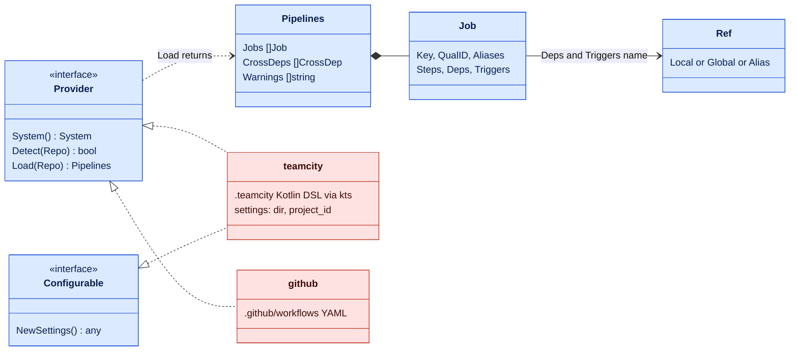
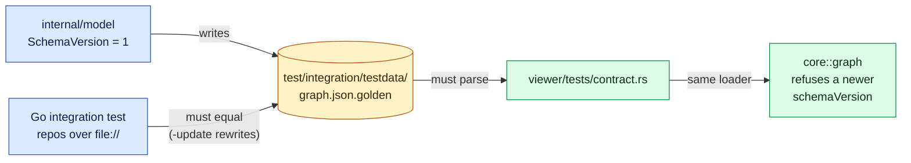
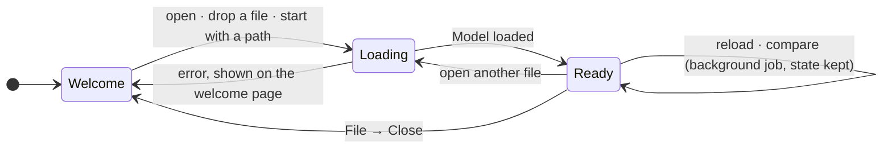
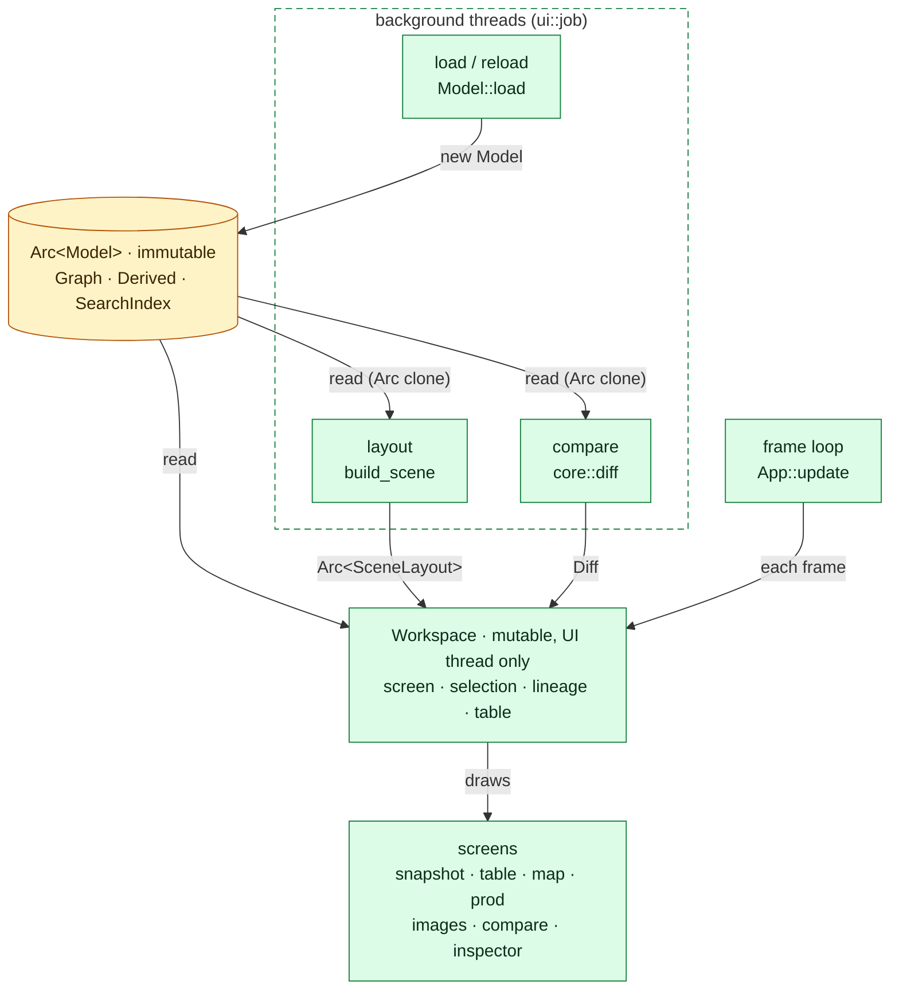
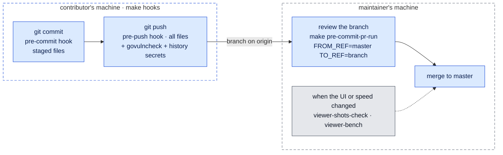
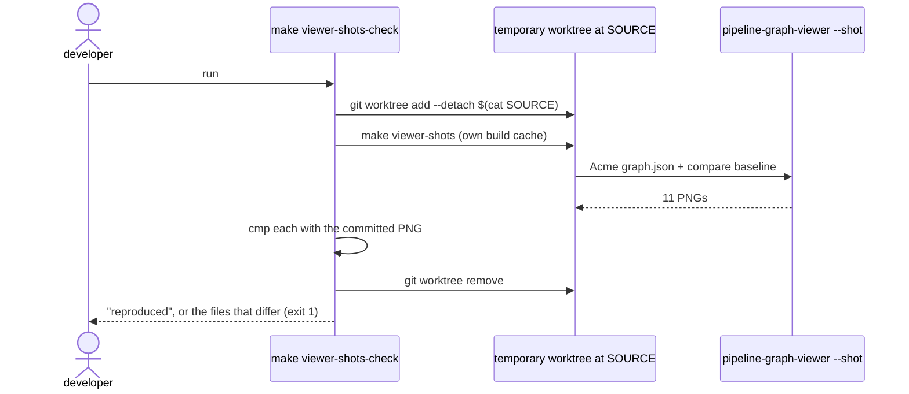
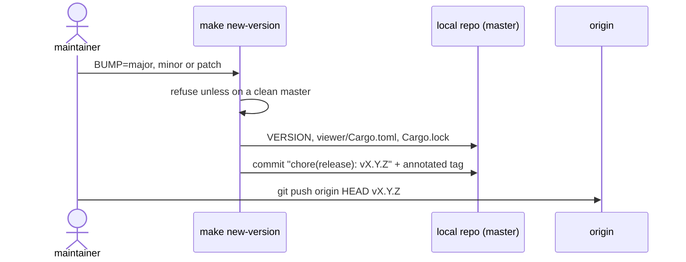

# Architecture

pipeline-graph has two programs that share one file format:

- **`pipeline-graph`** (Go, `cmd/pipeline-graph`) reads CI/CD definitions from git
  repositories and writes diagrams plus `graph.json`.
- **`pipeline-graph-viewer`** (Rust/egui, `viewer/`) is a desktop app for exploring
  `graph.json`.

Each diagram below answers one question, stated under its heading.

**Legend**, the same in every diagram:

| Colour | Meaning |
|---|---|
| 🟥 red | untrusted input: the analysed repositories |
| 🟦 blue | the Go CLI |
| 🟨 amber | data files and the contract between the two programs |
| 🟩 green | the Rust viewer |
| ⬜ grey | generated output |
| dashed box | a trust or runtime boundary |

## 1. Context and trust boundaries

*Answers: where does untrusted input enter, and what can it touch?*

- Repository content is **parsed, never executed**. The only programs the CLI starts are
  `git`, in `internal/fetch`, and Graphviz `dot`, on its own `pipelines.dot`.
- The container sees only what `make run` mounts: the project directory, the clone
  cache, and, read-only, what git needs to authenticate.
- Its only network traffic is git. `-serve` is a local file server for `out/`, mounted
  read-only (`make serve`).

## 2. Domain model

*Answers: what does the tool understand?*

Every relationship is many-to-many. In `graph.json` each edge has a direction, the way
work flows: from the dependency to what depends on it.

| Edge | From → to | Meaning |
|---|---|---|
| `snapshot`, `artifact` | build → build | the second needs the first (and its artifacts) |
| `trigger` | build → build | the first finishing starts the second |
| `runs` | build → make | a step runs `make <target>` |
| `depends`, `calls` | make → make | a prerequisite; a recipe running `make` again |
| `produces` | build or make → image | builds and pushes the image |
| `consumes` | image → build or make | pulls or uses the image |
| `runsIn` | image → build or make | the work runs inside a container of the image |
| `derives` | image → image | `FROM`: the second is built on the first |

Third-party images (`alpine`, `golang`, …) don't become nodes. An image node exists
only if an analysed pipeline produces it. A reference that resolves to no analysed
repository becomes an `external` stub and a warning.

## 3. One run of the CLI

*Answers: what happens in one run, and what flows between stages?*

| Package | Responsibility |
|---|---|
| `internal/config` | Loads the YAML; folds deprecated keys into provider blocks and reports them |
| `internal/fetch` | Shallow `git clone` with the system git and BatchMode ssh. Local directories are cloned too, so every repo has a commit |
| `internal/ci` | The provider seam (§4) and the neutral job model |
| `internal/kts` | Tolerant Kotlin tokenizer and parser for the TeamCity DSL |
| `internal/shell`, `internal/makefile` | Find `make`, `docker` and script calls in step text; parse Makefiles |
| `internal/analyze` | Turns every provider's jobs into one graph; resolves references across repositories |
| `internal/model` | The graph types and `graph.json` (`SchemaVersion`) |
| `internal/layout`, `internal/render` | Layered left-to-right layout with repository lanes; every output format |

## 4. The provider seam

*Answers: what does adding a CI system cost?*

Blue is shared by every system. Red reads one system's files from an untrusted
checkout. A new system is one package that returns neutral `ci.Job`s, plus one line
in `cmd/pipeline-graph/main.go`. Analysis, cross-repo resolution, the viewer and
every renderer stay as they are. See
[Adding a CI/CD system](development.md#adding-a-cicd-system).

## 5. The `graph.json` contract

*Answers: how can the Go and Rust halves never drift apart?*

The golden file is the only interface between the two languages. A model change fails
the Go test until the golden file is regenerated, and the regenerated file then has to
pass the Rust test. Both run in the quality gate. The viewer refuses a file newer than
it understands instead of showing it half-understood.

## 6. The viewer at run time

*Answers: what is shared, what is mutable, and what runs off the UI thread?*

The app moves through three phases:

Inside `Ready`, ownership is simple: one immutable model, one mutable workspace,
and threads that only ever produce new immutable values.

- `viewer/src/core` (graph, derive, search, layout, spatial, diff) doesn't depend on
  egui at all. That's what lets the unit tests, the contract test, the benchmarks and
  `ui::headless` run without a window.
- A reload builds a fresh `Workspace` around the new model, then carries over the
  selection, the screen, the table filter and the comparison.
- The budgets are checked on a synthetic graph with 48,000 nodes by `make viewer-bench`.
  It loads in about 0.3 s and stays at about 30 MB.

## 7. Defence in depth

*Answers: where is a mistake stopped before it reaches master?*

There is no CI/CD. Every check runs locally, in the same pinned Docker image
(`Dockerfile.pre-commit`), on the contributor's machine and again on the maintainer's.

The review step is what catches a branch from someone who never ran `make hooks`. It
runs the commit-stage hooks on exactly the branch's changes.

| Check | Catches | Runs at |
|---|---|---|
| gofmt, go vet, golangci-lint | Go style and bugs | commit, push, review |
| govulncheck | known vulnerabilities in Go dependencies | push only |
| `go test`: unit, integration (golden), `TestReadmeSampleOutput` | analyzer behaviour, a stale README sample | commit, push, review |
| cargo fmt, clippy, `cargo test`: unit, contract, headless smoke | Rust style, the `graph.json` contract, panics on any screen | commit, push, review |
| shellcheck, hadolint, Makefile parse | scripts, Dockerfiles, the Makefile | commit, push, review |
| gitleaks: staged / full history / working tree | committed secrets | commit / push / `make secrets` |
| `make viewer-bench` | load, search, layout and frame budgets | by hand |
| `make viewer-shots-check` | screenshots that no longer match their commit | by hand (needs a display) |

## 8. Reproducible screenshots

*Answers: how do we know the pictures in the docs are the real app at a known commit?*

The run is deterministic: no live mouse or keyboard input, the window always counts as
focused, a fixed 2000×1250 output, no animation, the time comes from the commit
(`SOURCE_DATE_EPOCH`), and the load time is left out. `SOURCE` records the commit.

## 9. Release

*Answers: how is a version cut?*

`VERSION` is the only place the version lives. `pipeline-graph -version`, the Docker
image tag and the viewer's About dialog derive from it. Until the push, `make
undo-version` takes the release back. A release is the commit and its tag. Nothing is
built or published: whoever needs a version checks out the tag and runs `make build`
and `make viewer`.

## Decisions

| Context | Decision | Consequence |
|---|---|---|
| The tool reads repositories it doesn't own | Static analysis only; nothing from them is executed | Safe on any repository and needs no CI server credentials. Anything decided at run time is invisible and shows up in `warnings.txt` |
| Several CI systems, one picture | One neutral job model behind `ci.Provider` | A new system doesn't touch analysis or rendering; system-specific detail has to fit `ci.Job` |
| Two languages, Go and Rust | `graph.json` with a golden file tested on both sides | Every shape change touches both sides and the golden file, on purpose |
| Graphs with tens of thousands of nodes | A native egui viewer next to the HTML one | Interactive at that size, at the cost of a second UI and builds per platform |
| The docs must show the real UI | The apps take their own screenshots | They can be rebuilt and checked; that needs a display (native) or a Chromium image (web) |
| The same results on every machine | The quality gate runs in a pinned Docker image | Docker is required |
| An internal tool; nothing is published | No CI/CD: git hooks on every machine plus a review run before merging | Nothing hosted to maintain or pay for, and no secrets in a CI system. The gate holds only if everyone runs `make hooks` and reviews really run `pre-commit-pr-run` |

## Known limits

- **Viewer screenshots are byte-identical only at the same display scaling.** At another
  scaling the map and commit → prod pictures differ in the anti-aliasing of curved
  links. The camera is identical, so the cause is in rasterization, and it isn't found yet.
- **The gate is only as good as its habits.** Nothing enforces `make hooks`. A branch
  from someone without hooks is checked only when the maintainer reviews it, and that
  review runs the commit stage: `govulncheck` and the history secret scan run only on
  push, on machines that have the hooks.
- **`make viewer-shots-check` and `make viewer-bench` are manual**, so neither is part
  of the gate.
- **Chromium isn't version-pinned** in `Dockerfile.screenshots`, because Debian removes
  superseded builds. The web screenshots can shift after a security update.
- **`make new-version` and `make undo-version` have no automated test.** Only their
  guards have been checked.

## Open question

**The `schemaVersion` policy.** Today the viewer refuses a newer file and accepts any
older one. Still open: when a change counts as a bump, and whether the viewer promises
to read older files (and for how long) or requires the current version.
