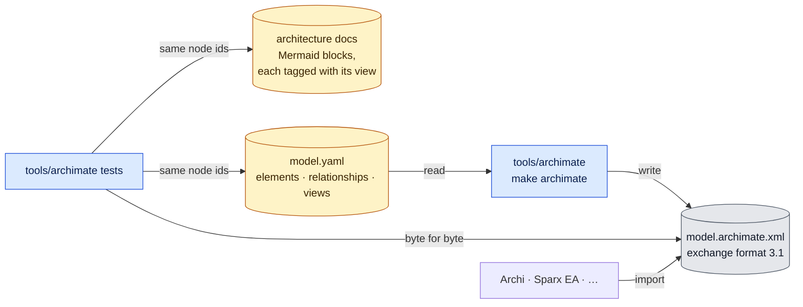

# The ArchiMate model

Every diagram in the architecture docs also exists as a view of one ArchiMate model,
[`model.archimate.xml`](model.archimate.xml), in the Open Group exchange format
(ArchiMate 3.1). Archi (*File → Import → Open Exchange XML Model*), Sparx EA, BiZZdesign
and other modelling tools import it. In the model, one element such as `internal/fetch`
or `graph.json` is shared by every view that shows it, so a tool can answer questions that a
picture can't, such as "where is `graph.json` used?".

Diagrams use the [legend](../architecture.md#legend); each answers the question
stated under its heading.

## How it stays in step

*Answers: what is the source, what is generated, and what fails when they drift?*

- **`model.yaml` is the source**, written by hand. The XML is generated from it and committed;
  don't edit the XML.
- **A diagram change is two edits**: the Mermaid block and `model.yaml`, then `make archimate`.
  The tests, which run on every commit, fail if:
  - a Mermaid block in `docs/architecture*.md` has no `%% view:` tag;
  - a tag has no view, or a view has no diagram;
  - a view's nodes differ from its diagram's node ids;
  - the committed XML differs from what `make archimate` writes;
  - an identifier is reused, a reference dangles, or a relationship isn't in the
    allowed list (`tools/archimate/model.go`).
- **What they don't catch:** changed labels, and arrows. A view draws the model's relationships
  between its elements (or the subset listed under `rels:`), not the Mermaid arrows.
- **Layout** is generated by `internal/layout`, one nesting level at a time: tidy, not pretty.
  Rearranging a view in a modelling tool changes only your copy.

## Mapping

| In the diagrams | In ArchiMate |
|---|---|
| a program, package or module | Application Component; parts by Composition |
| `ci.Provider`, `ci.Configurable` | Application Interface; providers implement them (Association) |
| `graph.json`, configs, caches, outputs, graph node kinds | Data Object |
| "A imports / uses B" | Serving, from B to A |
| "reads", "writes" | Access, with its access type |
| a step of one run, a viewer phase, a thread's job | Application Process; Flow or Triggering between them |
| a hook, a review, a release script | Technology Process; Triggering between them |
| your machine, a contributor's machine; the Docker container | Node; System Software |
| a git worktree, a repository on disk, the remote | Artifact |
| people | Business Actor |
| a dashed box that is only a boundary (`untrusted`, `out/`, threads) | Grouping |

**Lost on the way.**
- *Sequence diagrams*: the order of the messages. A view keeps who talks to whom.
- *State diagrams*: the initial state, and a transition from a state to itself (Ready → Ready).
- *The ER diagram*: cardinality. Every relationship there is many-to-many anyway.
- *Every diagram*: a relationship from an element to itself (BUILD → BUILD) is in the model but not drawn.
- **Not checked by the gate**: validation against the Open Group XSD needs xmllint and the
  schema files, which the pinned pre-commit image doesn't have. It was run by hand when
  the model was created:
  `xmllint --noout --schema archimate3_Diagram.xsd docs/architecture/model.archimate.xml`.
