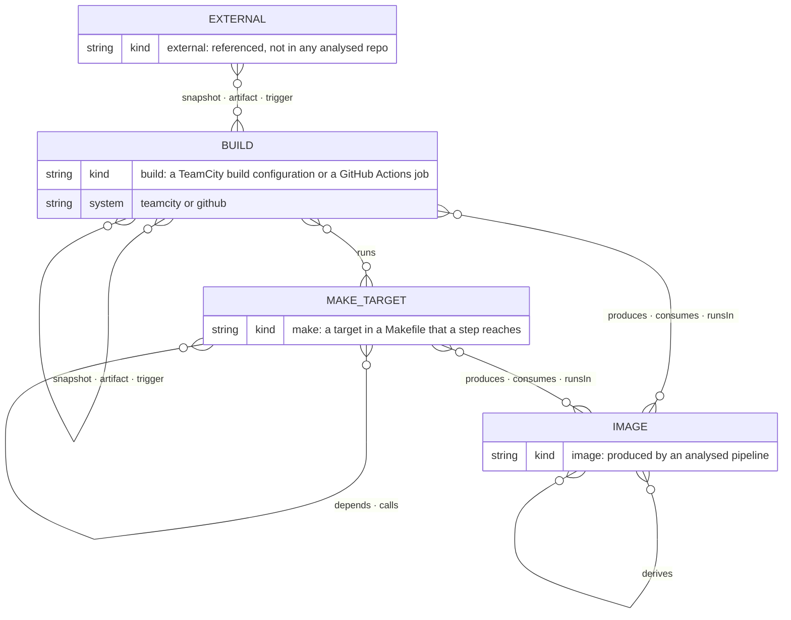
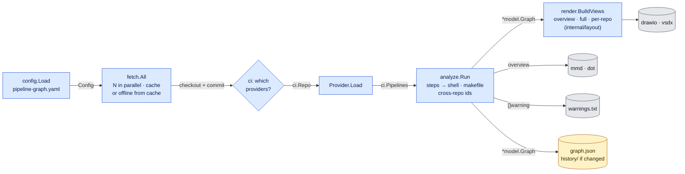
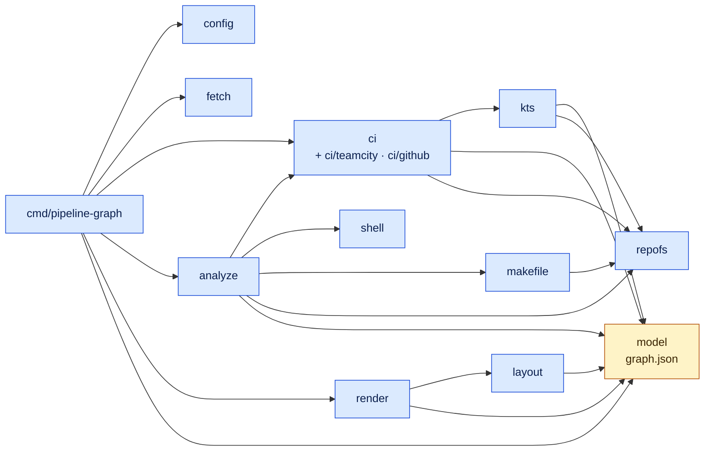
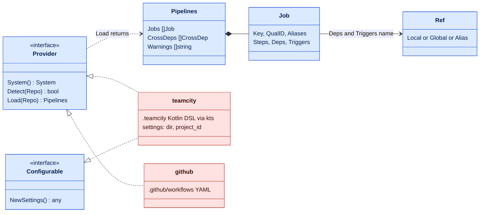

# The CLI

What the Go CLI (`cmd/pipeline-graph`) understands, what one run does, and how
a CI system plugs in.

Diagrams use the [legend](../architecture.md#legend); each answers the question
stated under its heading.

## Domain model

*Answers: what does the tool understand?*

Every relationship is many-to-many. In `graph.json` each edge has a direction, the way
work flows: from the dependency to what depends on it.

| Edge | From → to | Meaning |
|---|---|---|
| `snapshot`, `artifact` | build → build | the second needs the first (and its artifacts) |
| `trigger` | build → build | the first finishing starts the second |
| `runs` | build → make | a step runs `make <target>` |
| `depends`, `calls` | make → make | a prerequisite; a recipe running `make` again |
| `produces` | build or make → image | builds and pushes the image |
| `consumes` | image → build or make | pulls or uses the image |
| `runsIn` | image → build or make | the work runs inside a container of the image |
| `derives` | image → image | `FROM`: the second is built on the first |

Third-party images (`alpine`, `golang`, …) don't become nodes. An image node exists
only if an analysed pipeline produces it. A reference that resolves to no analysed
repository becomes an `external` stub and a warning.

## One run

*Answers: what happens in one run, and what flows between stages?*

## Packages

*Answers: which Go package imports which?*

An arrow is an import. Only `cmd/pipeline-graph` wires the stages together; `config`,
`fetch`, `shell` and `repofs` import nothing of ours, and everything ends in `model` or `repofs`.
`test/docs` fails when this picture and the real imports differ.

| Package | Responsibility |
|---|---|
| `internal/config` | Loads the YAML; folds deprecated keys into provider blocks and reports them |
| `internal/fetch` | Shallow `git clone` with the system git and BatchMode ssh, limited to http, https, ssh, git and file URLs. Each request has its own cache directory (readable name plus a hash of URL and branch), and only a directory this run created is ever deleted. Local directories are used in place |
| `internal/ci` | The provider seam ([below](#the-provider-seam)) and the neutral job model |
| `internal/kts` | Tolerant Kotlin tokenizer and parser for the TeamCity DSL |
| `internal/shell`, `internal/makefile` | Find `make`, `docker` and script calls in step text; parse Makefiles |
| `internal/repofs` | The only way repository files are read: confined to the repo root (no `..`, no symlink out), regular files only, size-capped |
| `internal/analyze` | Turns every provider's jobs into one graph; resolves references across repositories |
| `internal/model` | The graph types and `graph.json` (`SchemaVersion`) |
| `internal/layout`, `internal/render` | Layered left-to-right layout with repository lanes; every output format |

## The provider seam

*Answers: what does adding a CI system cost?*

Blue is shared by every system. Red reads one system's files from an untrusted
checkout. A new system is one package that returns neutral `ci.Job`s, plus one line
in `cmd/pipeline-graph/main.go`. Analysis, cross-repo resolution, the viewer and
every renderer stay as they are. See
[Adding a CI/CD system](../development.md#adding-a-cicd-system).
