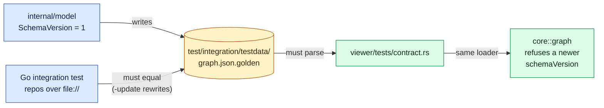

# The `graph.json` contract

The one file format the Go CLI writes and the Rust viewer reads, and how the two
are kept in step.

Diagrams use the [legend](../architecture.md#legend); each answers the question
stated under its heading.

*Answers: how can the Go and Rust halves never drift apart?*

The golden file is the only interface between the two languages. A model change fails
the Go test until the golden file is regenerated, and the regenerated file then has to
pass the Rust test. Both run in the quality gate: the `cargo test` hook runs on a commit that
touches `viewer/`, `internal/model/` or the golden file, so a Go-only change that alters the
contract is not waiting for the next viewer commit to be found out. The viewer refuses a file
newer than it understands instead of showing it half-understood.

## Open question

**The `schemaVersion` policy.** Today the viewer refuses a newer file and accepts any
older one. Still open: when a change counts as a bump, and whether the viewer promises
to read older files (and for how long) or requires the current version.
