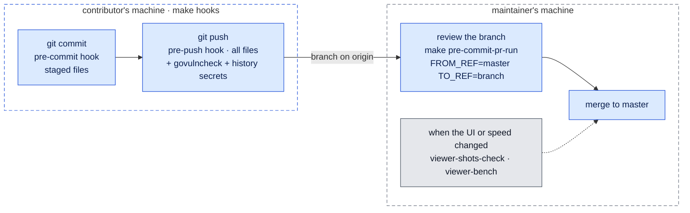
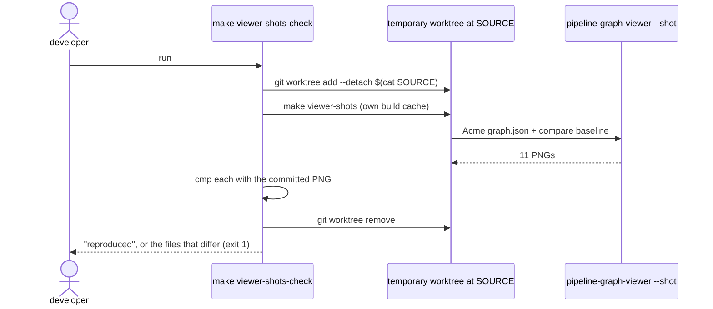
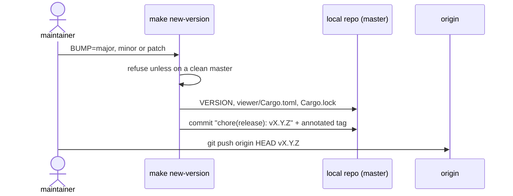

# Quality gate, screenshots and release

How a change is checked before it reaches master, how the doc screenshots are
proven real, and how a version is cut.

Diagrams use the [legend](../architecture.md#legend); each answers the question
stated under its heading.

## Defence in depth

*Answers: where is a mistake stopped before it reaches master?*

There is no CI/CD. Every check runs locally, in the same pinned Docker image
(`Dockerfile.pre-commit`), on the contributor's machine and again on the maintainer's.

The review step is what catches a branch from someone who never ran `make hooks`. It
runs the commit-stage hooks on exactly the branch's changes.

| Check | Catches | Runs at |
|---|---|---|
| gofmt, go vet, golangci-lint | Go style and bugs | commit, push, review |
| govulncheck | known vulnerabilities in Go dependencies | push only |
| `go test`: unit, integration (golden), `TestReadmeSampleOutput` | analyzer behaviour, a stale README sample | commit, push, review |
| cargo fmt, clippy, `cargo test`: unit, contract, headless smoke | Rust style, the `graph.json` contract, panics on any screen | commit, push, review |
| shellcheck, hadolint, Makefile parse | scripts, Dockerfiles, the Makefile | commit, push, review |
| gitleaks: staged / full history / working tree | committed secrets | commit / push / `make secrets` |
| `make viewer-bench` | load, search, layout and frame budgets | by hand |
| `make viewer-shots-check` | screenshots that no longer match their commit | by hand (needs a display) |

## Reproducible screenshots

*Answers: how do we know the pictures in the docs are the real app at a known commit?*

The run is deterministic: no live mouse or keyboard input, the window always counts as
focused, a fixed 2000×1250 output, no animation, the time comes from the commit
(`SOURCE_DATE_EPOCH`), and the load time is left out. `SOURCE` records the commit.

## Release

*Answers: how is a version cut?*

`VERSION` is the only place the version lives. `pipeline-graph -version`, the Docker
image tag and the viewer's About dialog derive from it. Until the push, `make
undo-version` takes the release back. A release is the commit and its tag. Nothing is
built or published: whoever needs a version checks out the tag and runs `make build`
and `make viewer`.

## Known limits

- **Viewer screenshots are byte-identical only at the same display scaling.** At another
  scaling the map and commit → prod pictures differ in the anti-aliasing of curved
  links. The camera is identical, so the cause is in rasterization, and it isn't found yet.
- **The gate is only as good as its habits.** Nothing enforces `make hooks`. A branch
  from someone without hooks is checked only when the maintainer reviews it, and that
  review runs the commit stage: `govulncheck` and the history secret scan run only on
  push, on machines that have the hooks.
- **`make viewer-shots-check` and `make viewer-bench` are manual**, so neither is part
  of the gate.
- **`make new-version` and `make undo-version` have no automated test.** Only their
  guards have been checked.
