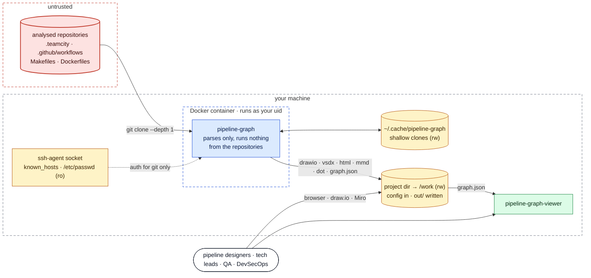

# Security: context and trust boundaries

Where untrusted input enters pipeline-graph, and what it can touch.

Diagrams use the [legend](../architecture.md#legend); each answers the question
stated under its heading.

*Answers: where does untrusted input enter, and what can it touch?*

- Repository content is **parsed, never executed**. The only programs the CLI starts are
  `git`, in `internal/fetch`, and Graphviz `dot`, on its own `pipelines.dot`.
- Repository files are read only through `internal/repofs`: a path that leaves the
  repository (`..`, an absolute path, a symlink out), anything that is not a regular file
  (fifo, device) and any file over 4 MiB is refused with a warning, so a hostile
  `include ../../.env` or a symlink to a secret never reaches `graph.json`.
- The container sees only what `make run` mounts: the project directory, the clone
  cache, and, read-only, what git needs to authenticate.
- Its only network traffic is git. `-serve` is a local file server for `out/`, mounted
  read-only (`make serve`).
