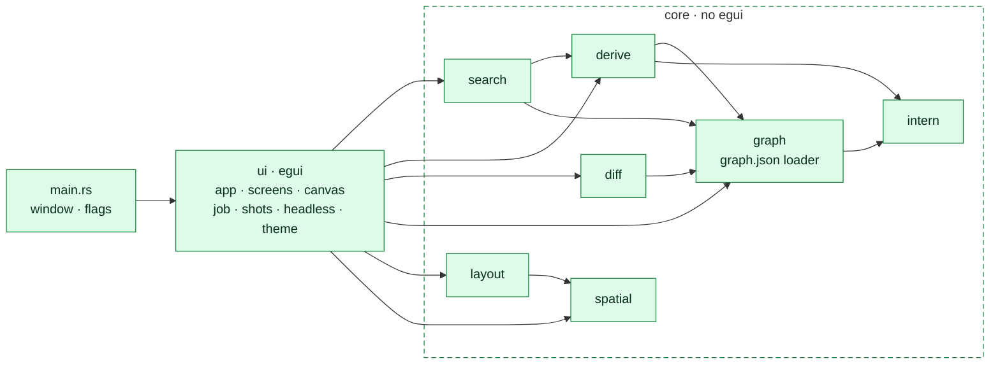
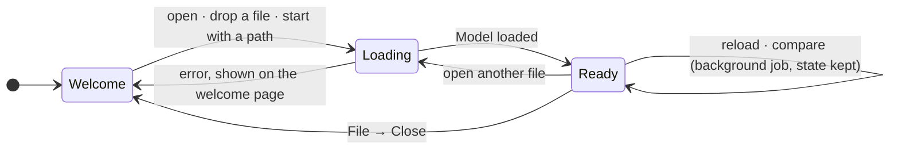
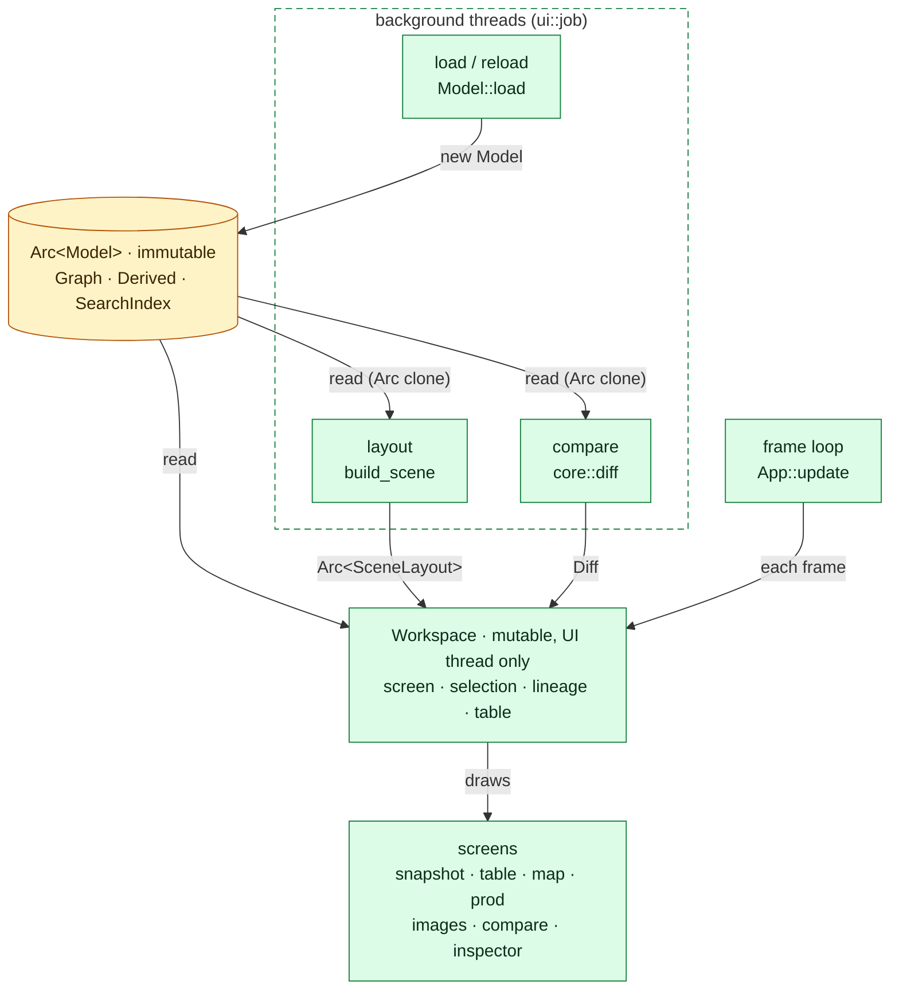

# The viewer

How `pipeline-graph-viewer` (`viewer/`) is built and how it behaves while it runs.
For what it shows and how to use it, see [the viewer guide](../pipeline-graph-viewer.md).

Diagrams use the [legend](../architecture.md#legend); each answers the question
stated under its heading.

## Modules

*Answers: which module uses which, and what keeps `core` free of the UI?*

An arrow is a `use`. Arrows only point into `core`, never out of it, and nothing in
`core` names egui. `ui` is drawn as one box because its modules all meet in
`ui::app`. `test/docs` fails when this picture and the code differ, or when `core`
reaches for `ui` or egui.

## Run time

*Answers: what is shared, what is mutable, and what runs off the UI thread?*

The app moves through three phases:

Inside `Ready`, ownership is simple: one immutable model, one mutable workspace,
and threads that only ever produce new immutable values.

- `viewer/src/core` (graph, derive, search, layout, spatial, diff, intern) doesn't depend on
  egui at all. That's what lets the unit tests, the contract test, the benchmarks and
  `ui::headless` run without a window.
- A reload builds a fresh `Workspace` around the new model, then carries over the
  selection, the screen, the table filter and the comparison.
- The budgets are checked on a synthetic graph with 48,000 nodes by `make viewer-bench`.
  It loads in about 0.3 s and stays at about 30 MB.
