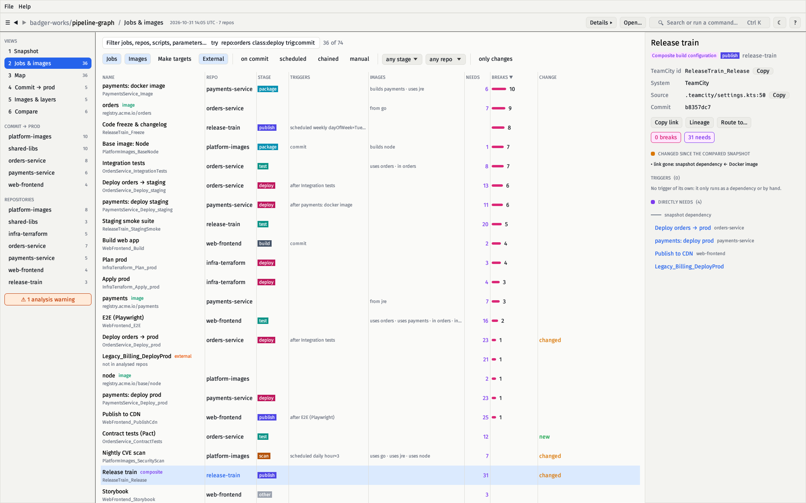
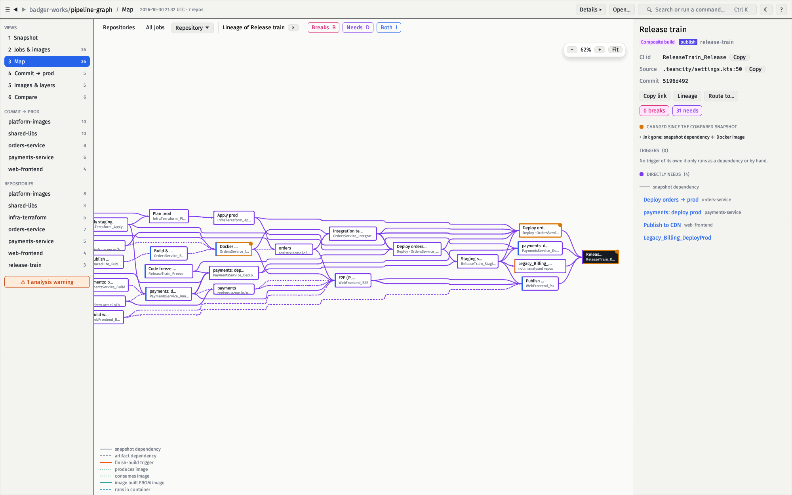
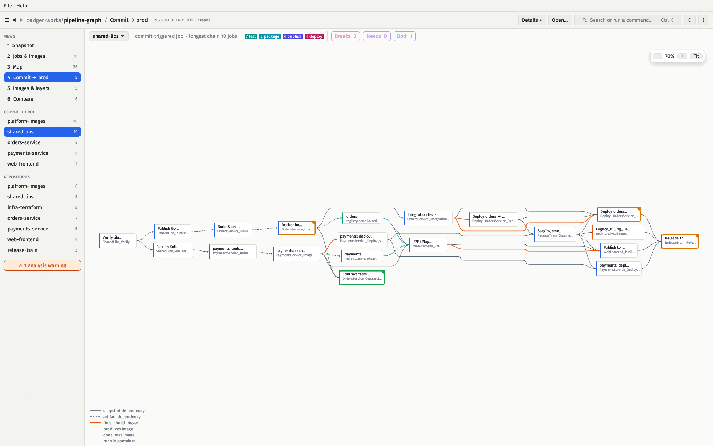
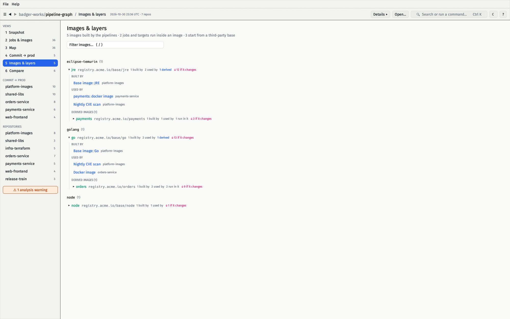
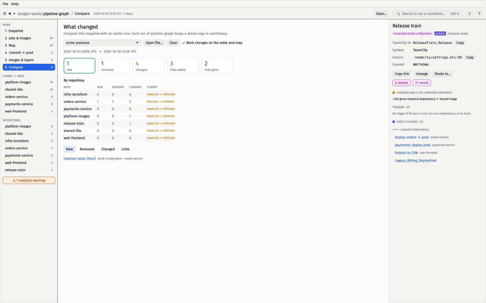
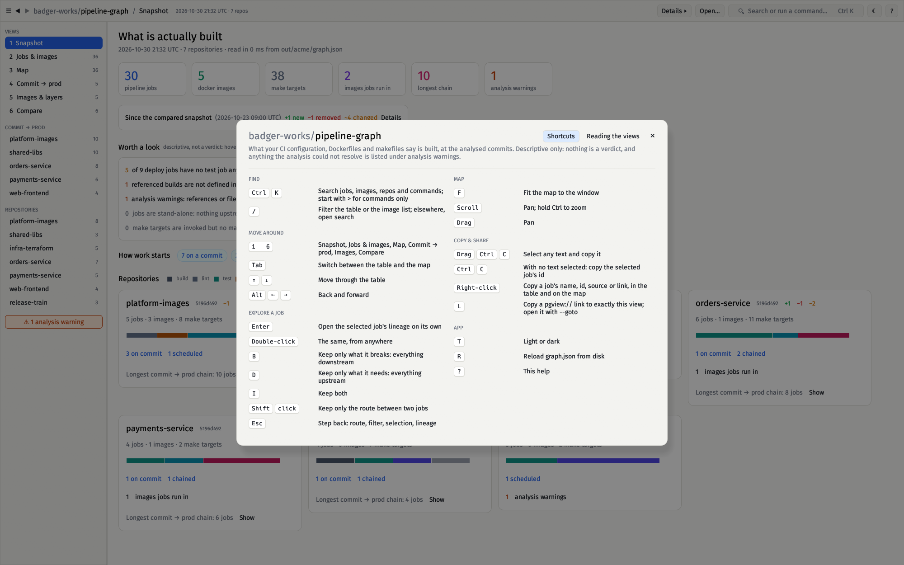
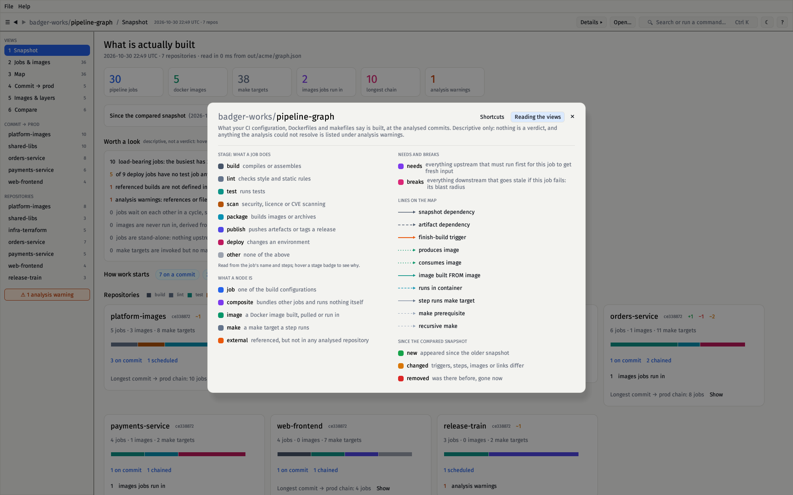

# The pipeline-graph viewer: a native app

`pipeline-graph-viewer` is a native desktop app that reads the `graph.json` pipeline-graph
writes and shows what your pipelines **actually do**: not what the plan says,
what the files in the repositories say. It is made for the people who decide how
pipelines should be built, a quality lead and a tech lead, who need two things
at once: an **overview** of everything that exists, and **depth** on any one
job, down to the script it runs and the container it runs in.

It is plain Rust and egui. There is no server, no browser and no network. It
opens 48,000 nodes (3,000 jobs, 45,000 make targets, layered images) in about
0.3 s, holds the graph in about 30 MB, and redraws in well under a
millisecond of CPU per frame; [the budgets](#performance) are checked by
`make viewer-bench`.


## Running it

```sh
make run            # or: make example, writes out/graph.json
make view           # builds pipeline-graph-viewer and opens out/graph.json
make view GRAPH=out/acme/graph.json COMPARE=viewer/testdata/acme-previous.json
```

or, after `cargo build --release --manifest-path viewer/Cargo.toml`:

```sh
pipeline-graph-viewer [graph.json] [--compare older/graph.json] [--goto pipeline-graph://table?q=repo:orders] [--theme light|dark]
```

Without a file it opens `./out/graph.json`, or asks for one; you can also drop a
file on the window. It needs only a desktop session (X11 or Wayland, Windows or
macOS) and a GPU driver with OpenGL.

## The screens

Keys `1`–`6` switch between them; `Tab` flips between the table and the map.

### 1 Snapshot: the reality at a glance

One page that answers "what do we have?": jobs, images, make targets, which
images jobs run inside, the longest commit → prod chain, and what the analysis
could not resolve. Then **Worth a look**, the facts a pipeline designer would
want to check, the ones that occur listed first:

- **deploy jobs with no test job anywhere upstream**
- builds referenced but **not found** in any analysed repository
- **analysis warnings**
- **stand-alone jobs** with nothing upstream or downstream
- **make targets that are invoked but have no rule**
- **jobs in a cycle**: they wait on each other, so none has a start order
- **load-bearing jobs**: the ten with the most jobs transitively depending on
  them (at least three); a click lists them
- **images nothing uses**: not run in, derived from or consumed

After that, **how work starts** (on a commit, on a schedule, when another job
finishes, by hand), and a card per repository with its mix of stages (build,
lint, test, scan, package, publish, deploy) and the same facts for that
repository.

Every number is a link: it opens the table filtered to exactly the jobs it
counts. Hover one to read what it counts and why it can matter. The page never
says pass or fail; it states what is there and lets you judge.

### 2 Jobs & images: every one, sortable

A virtualized table of every job, image and make target (tens of thousands of
rows stay instant) with its stage, triggers, images, **Needs** (everything
upstream) and **Breaks** (everything downstream). Click a header to sort, type
to filter, `↑`/`↓` to walk the rows, `Enter` or double-click to open a job's
lineage.



### 3 Map: the structure

The map shows what you ask for, never everything at once:

| Scene | What it is |
|---|---|
| **Repositories** | One box per repository, with the number of links between them. The start on big graphs. Click a box to open it. |
| **Repository** | A repository's jobs and what touches them from outside, in repository lanes. |
| **All jobs** | Every job and image in lanes. |
| **Lineage** | One job's upstream and downstream on its own (double-click a job). |

Only what is on screen is drawn, so panning stays smooth at any size, and cards
show less when zoomed out (titles only, then details). A scene is cut to its
nearest 500 nodes, with a **Show more** button, because a layout of thousands of
jobs is unreadable anyway.

Select a job and the map colours **what it needs** violet and **what it
breaks** pink. `B`, `D` and `I` keep only one side or both; `Shift`+click a
second job keeps only the route between the two. Each card shows the job's
[stage](#how-the-facts-are-derived), its trigger and how many jobs are
downstream of it.



### 4 Commit → prod

For one repository: every job a commit sets in motion and everything downstream
of it, laid out in dependency order and coloured by stage. A header counts the
stages and states plainly when a deploy job has **no test job upstream**.



### 5 Images & layers

The base → intermediate → application image tree: which third-party image each
chain starts from, who builds every image, who uses it, **which jobs run inside
it** (a Yocto SDK container, a build image), and how many jobs rebuild if it
changes.



### 6 Compare: what drifted

Each run of `pipeline-graph` keeps a dated copy of `graph.json` in
`out/history/` (only when the graph changed). Pick one here, or start with
`--compare`, and see jobs added, removed and **changed**, with the field that
changed: a step's script, a trigger, a parameter, an artifact rule, a new or
vanished link. The commit each repository was analysed at is shown too. The
changes are also marked on the table and the map, so the question "what is
different since last week?" can be asked of any job.



## The inspector

Select anything and the panel on the right shows, in the order a reviewer asks:
what it is and where it is defined (a link to the file and line at the analysed
commit on GitHub, GitLab, Bitbucket and Gitea), what **triggers** it, the
**container** it runs in and the layers that container is built on, what it
directly needs and what directly needs it (by kind of link), the **make
targets it runs** as a tree you can open level by level, every step with its
full script, parameters and artifact rules. Everything has a copy button.

Jobs are named in the words of the CI system they come from, which
`graph.json` records (`systems`): a TeamCity job is a *build configuration* with
a *TeamCity id*, a GitHub Actions job a *workflow job* with a *job path*. The
inspector also says which **System** it is. A `graph.json` from before that
was recorded uses the generic wording.

Any text that carries information can be selected with the mouse and copied
with `Ctrl`+`C`: ids, sources, scripts, facts, warnings, compare notes. Text
that acts as a link (a job name you click to open) is not selectable. In the
table, where a whole row is a click target, right-click a row to copy its
name, id, source or a link; on the map, right-click a card. `Ctrl`+`C` with no
text selected copies the selected job's id.

## Search and filters

`Ctrl`/`⌘`+`K` opens the palette: type to find any job, image or target by name,
CI id, script text or parameter, or type `>` to see only commands. `Enter`
opens a result, `Shift`+`Enter` opens its lineage. In the table filter and the
palette you can narrow with:

| Filter | Example | Meaning |
|---|---|---|
| `repo:` | `repo:orders` | repository name contains |
| `kind:` | `kind:image` | `build`, `image`, `make`, `external` |
| `class:` | `class:deploy` | the stage: `build lint test scan package publish deploy other` |
| `trig:` | `trig:commit` | `commit`, `schedule`, `chained`, `manual` |
| `is:` | `is:notest` | `isolated`, `notest`, `container`, `undefined`, `cycle`, `unused`, `hub` |

Every state has a link: `L` copies a `pipeline-graph://…` link to exactly this view,
and `--goto` opens one.

## Menus

**File** has Open, Close, Save as (writes a copy of the open `graph.json`),
Reload and Quit. Save is greyed out: the viewer never changes the file.
**Help** opens the shortcuts and legend, and an About dialog with the version.

## Keyboard and help

`?` opens the help: every shortcut grouped by what you want to do, and
**Reading the views**, a legend of stage colours, node kinds, needs and breaks,
the lines on the map and the change markers.





| Key | |
|---|---|
| `Ctrl`/`⌘` `K` | search and commands |
| `/` | filter the table, or search |
| `1` – `6`, `Tab` | screens; table ↔ map |
| `↑` `↓` `PgUp` `PgDn` `Enter` | table rows; open lineage |
| `B` `D` `I` | keep what it breaks / needs / both |
| `Shift`+click | the route between two jobs |
| `F` | fit the map |
| `Esc` | step back: route, lineage, selection |
| `Alt` `←` `→` | back, forward |
| `Ctrl` `C`, right-click | copy the selection, or the selected job's id; copy menu |
| `L` `T` `R` `?` | copy link, light/dark, reload, help |
| `Ctrl`/`⌘` `O` `W` `Shift`+`S` `Q` | open, close, save a copy, quit |

## How the facts are derived

Everything is computed from `graph.json`, which is static analysis of the
checked-out files. Nothing is executed and nothing talks to a CI server, so the
facts describe what is **defined**, not what ran.

- **Stage** (build, lint, test, scan, package, publish, deploy) is a
  deterministic heuristic: the words in a job's name first, then its steps, the
  make targets it runs and its scripts. Hover the stage pill in the inspector for
  the reason (“the name has *deploy*”). A job that matches nothing is *other*.
- **No test upstream** means no job classed *test* is reachable going upstream.
  It says nothing about tests that run inside a deploy job.
- **Needs / breaks** are the transitive upstream and downstream of the job in the
  pipeline flow (make targets are shown separately; images produced or used in
  make are attached to the jobs that run those targets).
- **Chain length** is the longest path of jobs from a commit-triggered job.
- **Runs in a container** is found for `docker run <image>` in scripts and make
  recipes and for GitHub Actions `container:`. **Built on** comes from the
  `FROM` lines of the Dockerfiles it can read. Container steps of TeamCity
  (`dockerImage`) are not read yet.

## Performance

The budgets below are measured on a generated 48,500-node graph by
`make viewer-bench`, which fails when one is missed:

| | Budget | Measured here |
|---|---|---|
| Load and index | 1 s | 80 ms |
| Derive classes and reach for every node | 3 s | 200 ms |
| A search keystroke | 25 ms | < 4 ms |
| A lineage query | 2 ms | 0.03 ms |
| Lay out a scene of 500 nodes | 700 ms | < 10 ms |
| A frame (p95, CPU) | 8 ms | < 2 ms |
| Memory held for the graph | 400 MB | ~32 MB |
| Whole process, window and GL included | | ~120 MB |
| CPU while idle | | 0 (it repaints only on input) |

Layout is the one cost that grows fast: about 0.4 s for 2,000 nodes and 4 s for
3,500, which is why a scene is cut to its nearest 500 until you ask for more.

How: strings are interned, nodes are stored as parallel arrays with compressed
adjacency, search is a substring scan over two flat buffers, layouts run on a
worker thread and are cached, and only the nodes and edges that intersect the
window are drawn. It repaints only on input, so it uses no CPU while idle.

## Development

The crate is in [`viewer/`](../viewer): `src/core` has no GUI code (graph,
derived facts, search, layout, diff) and is unit-tested; `src/ui` is the egui
application. `tests/contract.rs` reads the analyzer's own golden `graph.json`, so
a change on either side that breaks the contract fails the build.

```sh
make viewer-test     # unit, contract and smoke tests
make viewer-bench    # performance budgets on 48k nodes
make viewer-shots        # regenerate docs/screenshots/pipeline-graph-viewer (needs a display)
make viewer-shots-check  # rebuild them from their SOURCE commit and compare byte for byte
```

`pipeline-graph-viewer --shot DIR` is how the screenshots are made: the app drives itself
through its screens and saves a picture of each. The pictures are the same on every run
at the same display scaling: 2000×1250 pixels at any scaling, no animation, the mouse and
keyboard ignored, and no load time on the snapshot. At a different scaling the map and
commit → prod pictures differ slightly in how the curved links are anti-aliased. `SOURCE` next to them is the commit they
show. If the window manager will not give the window that size (a tiling one, say), the
run stops and says so instead of saving different pictures.
