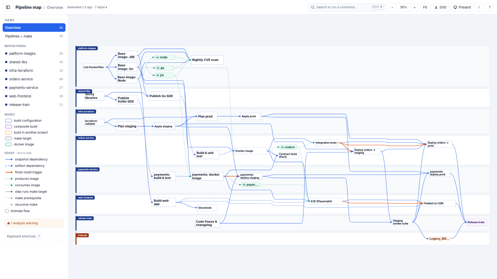
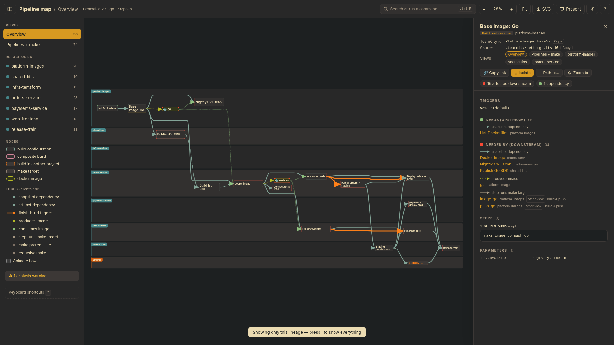
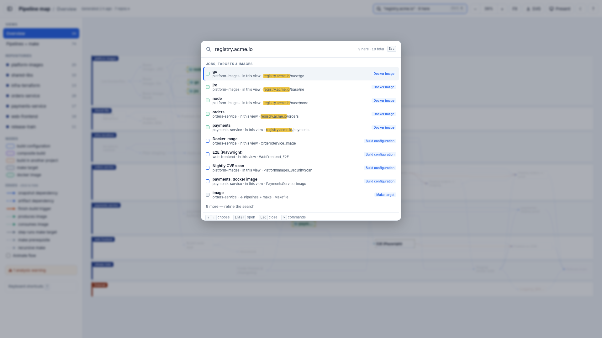
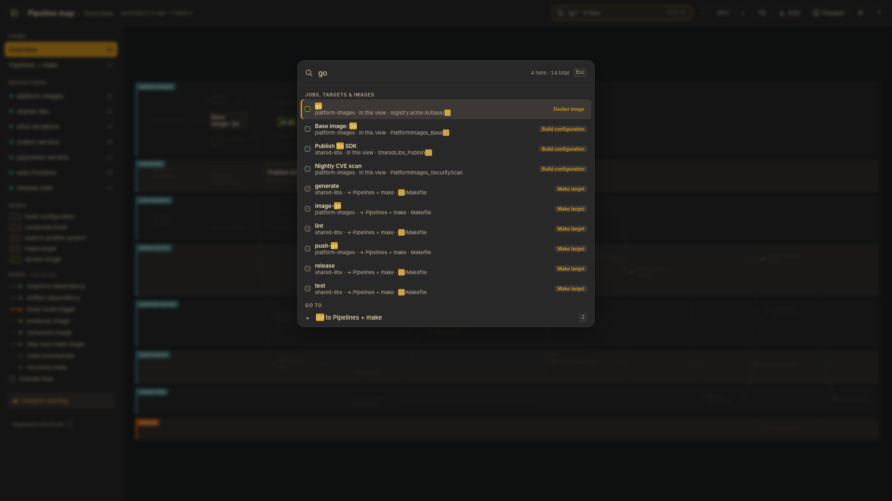
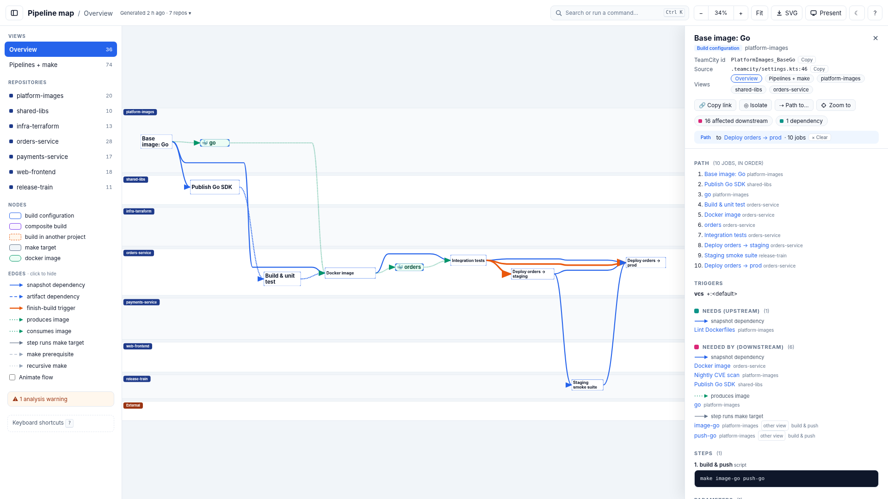
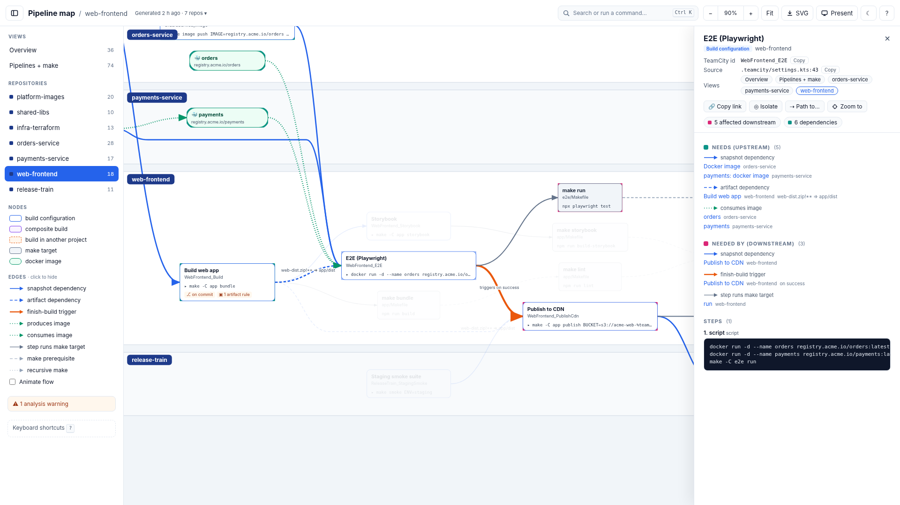
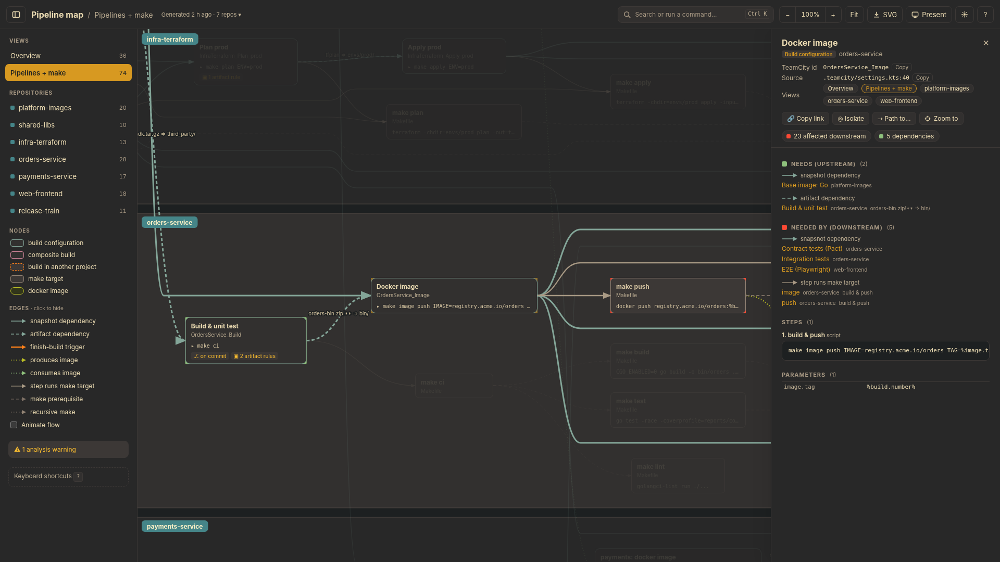
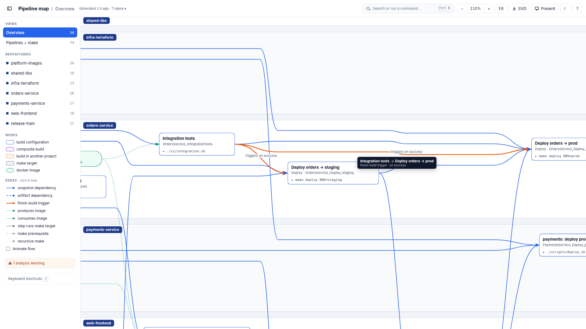
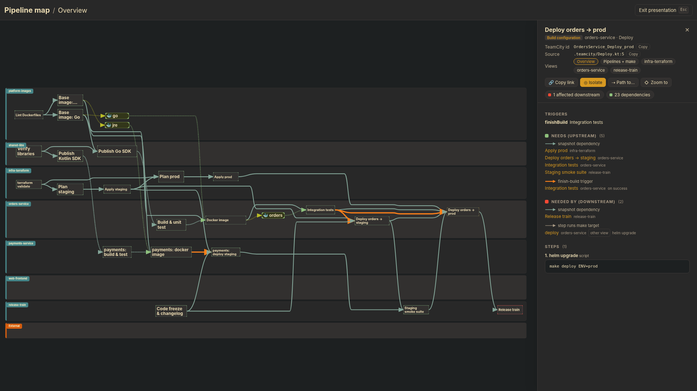
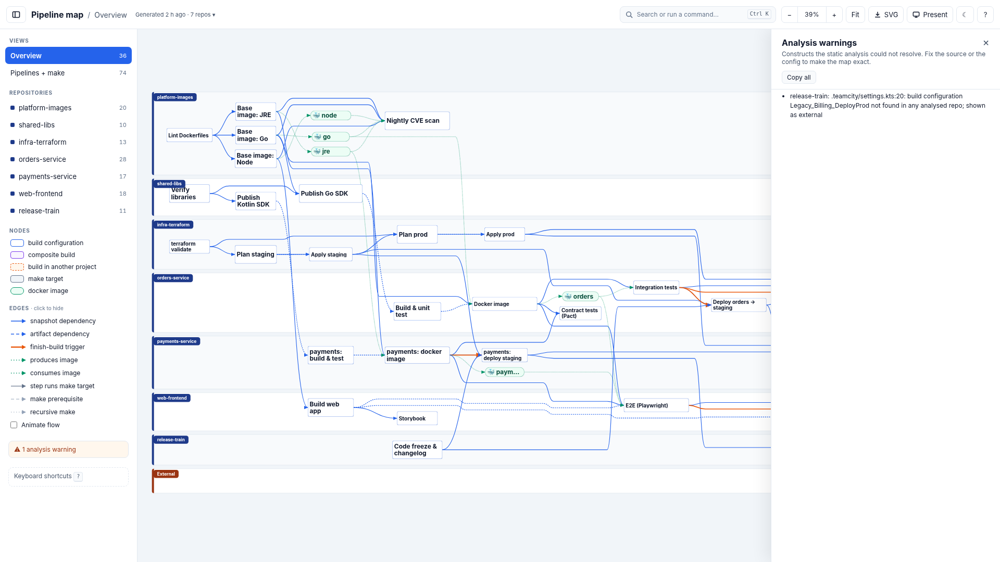

# Screenshots

Generated by `make screenshots` from the [Acme example](../../examples/acme); do not edit by hand.

## Every pipeline, every repo, one page

Seven repositories, their TeamCity build configurations, snapshot and artifact dependencies, finish-build triggers, and the docker images passed between them. Each repo is a lane, and work flows left to right.

## Blast radius of a base image change

A CVE lands in the Go base image: what rebuilds, what gets redeployed, and through which links? Clicking a node colours its upstream green and its downstream red. `I` hides everything else. The URL now points at this exact view, ready to paste into the incident channel.

## Supply chain questions in one search

`/` searches every view: names, TeamCity ids, step scripts and parameters. Here it lists every job, make target and image that mentions the internal registry, i.e. everything that pushes or pulls images.

## One palette for jobs and commands

`/` or `Ctrl/⌘ K` opens the palette: jobs, targets and images on top, matching commands below. Type `>` for commands only: blast radius, dependencies, copy a TeamCity id, switch view, export.

## How does this reach production?

Select a job, then `Shift+click` another (or pick it from the palette): only the routes between them stay, with the jobs on the path listed in order. The URL carries both ends.

## What does this test job actually run?

The per-repo view shows a repository together with its cross-repo neighbours. The side panel shows what triggers the E2E suite, what it waits for, what runs after it, the exact script, and the file and line that define it (a link to the analysed commit when the repo is on GitHub, GitLab, Bitbucket or Gitea).

## From TeamCity step down to the Makefile

The *Pipelines + make* view follows each build step into the make targets it calls, their prerequisites, and recursive `make -C` calls, across included `.mk` files.

## Every arrow explains itself

Hover any link to see what it connects and why: a snapshot or artifact dependency (with its artifact rules), a finish-build trigger, or a produced or consumed image.

## Presentation mode for screen sharing

`P` hides the controls and enlarges the text, and `I` keeps only one lineage. This view is every path to production for the orders service, from the base images to the release train, for a release review or a post-mortem call.

## Nothing is dropped silently

Anything the static analysis could not resolve is listed here and in `warnings.txt`. Here, a build configuration lives in a repo that was not analysed, so it is drawn as an external node.

